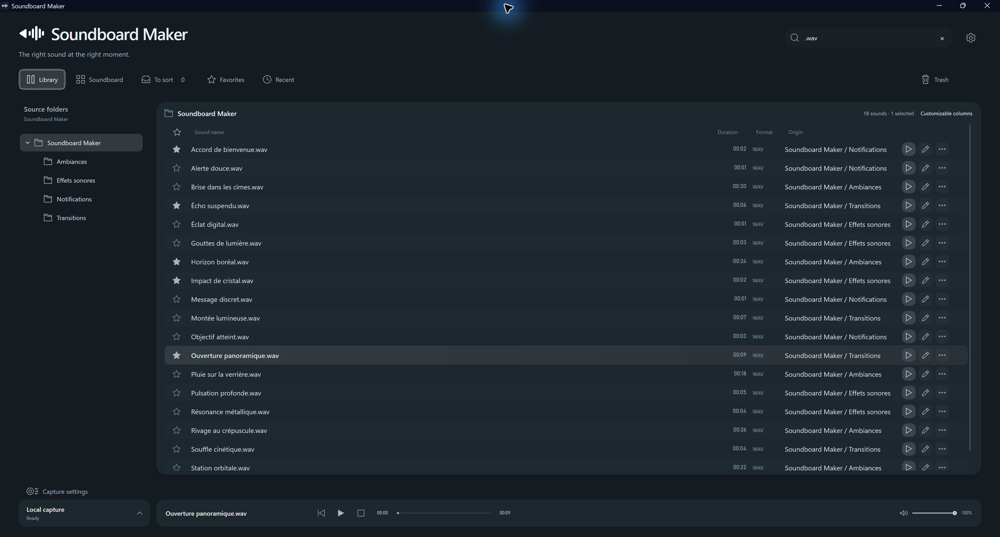
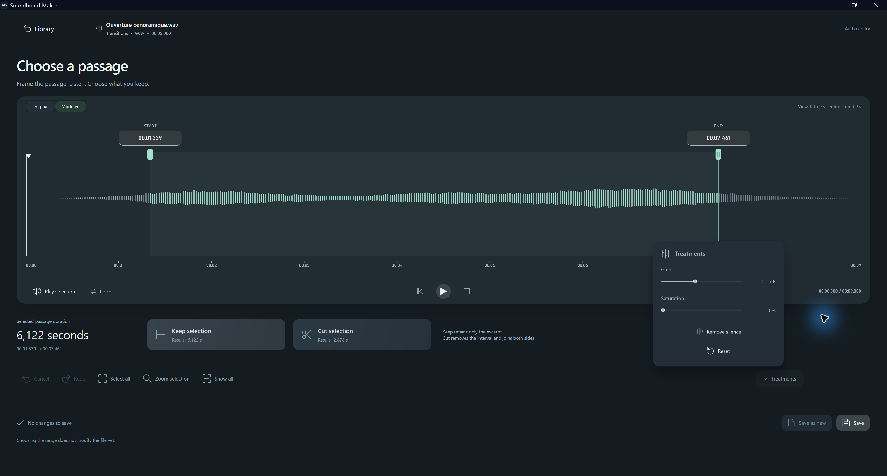
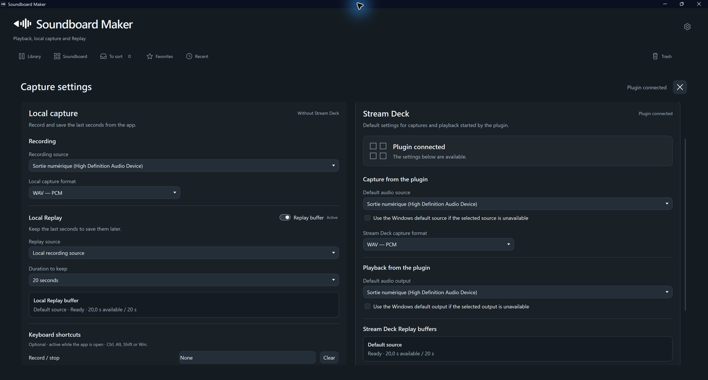
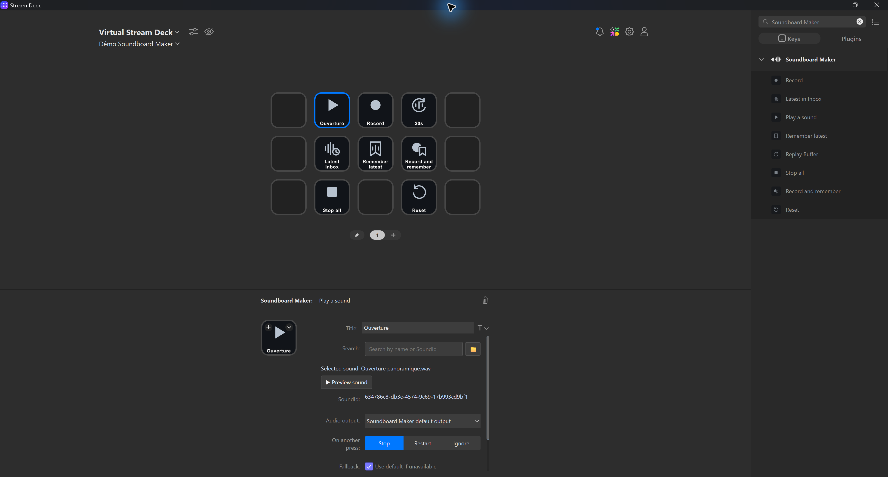

  
  <h1>Soundboard Maker</h1>
  
<strong>Your sounds. Your control.</strong>

  
A Windows app to organize, edit, record and trigger audio, with Stream Deck integration.

  
<strong>Windows 11 · Audio Editor · Capture & Replay · Stream Deck</strong>

  
<strong>🚀 Version 1.0 coming soon</strong>

  
<a href="README.md">Français</a> · <a href="docs/INSTALLATION.en.md">Installation</a> · <a href="docs/FAQ.md">FAQ (FR)</a> · <a href="https://github.com/Fablitox/SoundBoardMaker/releases">Releases</a>

---

## See the application

<table>
  <tr>
    <td align="center">
      
       <b>Sound library</b>
    </td>
    <td align="center">
      
       <b>Audio editor</b>
    </td>
  </tr>
  <tr>
    <td align="center">
      
       <b>Capture & Replay</b>
    </td>
    <td align="center">
      
       <b>Stream Deck</b>
    </td>
  </tr>
</table>

*Four real screenshots of the application. Click a thumbnail to view its full-size image.*

## One place for all your sounds

Soundboard Maker brings a local sound library, integrated audio editing, playback controls, system-audio recording and Replay Buffer into a single Windows application.

| Library | Audio editor | Capture & Replay | Stream Deck |
| --- | --- | --- | --- |
| Folders, search, favorites, pages and recent sounds. | Trim, preview, edit and save a separate copy. | Record system audio and save the last seconds. | Trigger sounds, remember tracks, record and stop playback. |

### Features

- **Local sound library:** import, organize, search and favorite audio files while preserving track identifiers.
- **Integrated editor:** accurate selection, trimming, undo/redo, previews and export to supported formats.
- **Independent playback:** trigger more than one sound and use the available output-routing options.
- **Audio capture:** record system audio from the desktop app or Stream Deck actions.
- **Replay Buffer:** save the last seconds of a captured stream, with a configurable duration.
- **Stream Deck plugin:** configurable playback, recording, latest sound, memory, replay and stop-all actions.
- **French and English interface.**

> Playback and save/export formats may differ depending on the feature.

## Play sounds through your microphone (Discord, games…)

**Wave Link is required for the virtual-microphone routing supported by Soundboard Maker.** To let others hear your sounds in Discord or in-game voice chat as part of your microphone input, route the audio through **Elgato Wave Link** and choose its virtual microphone output (for example, **Wave Link MicrophoneFX**) as your voice-chat input.

**Wave Link is not required just to listen to sounds** through your speakers or headphones. Soundboard Maker does not create its own virtual microphone device.

See the [setup guide](docs/INSTALLATION.en.md#play-sounds-through-your-microphone).

## Downloads

**The first public release (1.0) is being prepared. There are no downloads available here yet.**

When released, the [Releases](https://github.com/Fablitox/SoundBoardMaker/releases) page will provide only:

| File | Purpose |
| --- | --- |
| **Windows installer (.exe)** | Install or update Soundboard Maker. |
| **Stream Deck plugin (.streamDeckPlugin)** | Install the Elgato integration manually until it becomes available on Marketplace. |

**No portable ZIP distribution is planned.** Always verify the file version and source before running an installer.

## Installation and support

See the [installation guide](docs/INSTALLATION.en.md). Soundboard Maker targets 64-bit Windows 11. Stream Deck features require the Elgato Stream Deck software and the matching plugin.

Found a bug or have feedback? Open an [issue](https://github.com/Fablitox/SoundBoardMaker/issues) and follow the [support guidelines](docs/SUPPORT.md). Please do not upload personal sound files, private logs or API tokens.

## About this repository

This **public** repository hosts Soundboard Maker's presentation, documentation and official downloads. **The application source code and development history remain private.** This repository is not an open-source release.

© 2026 Soundboard Maker. All rights reserved.
