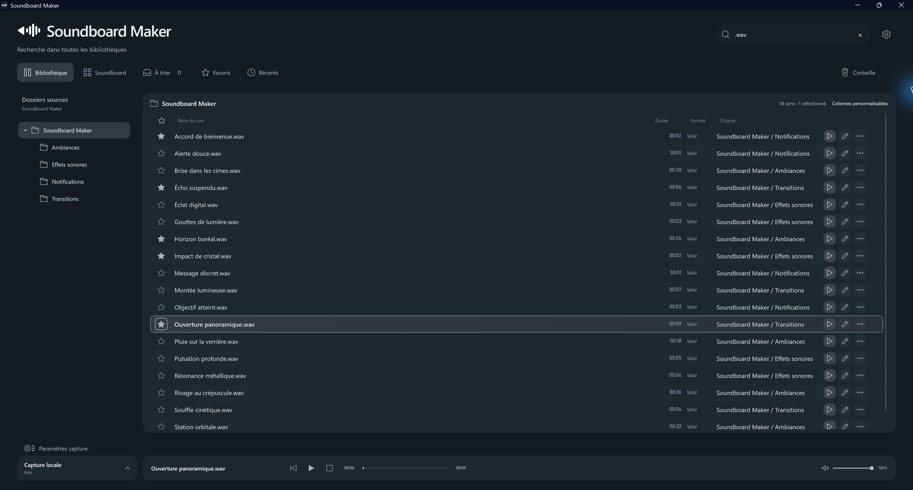
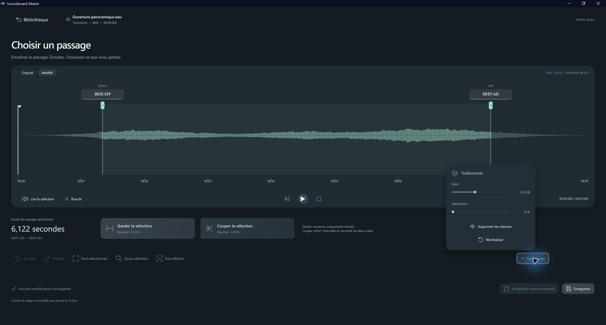
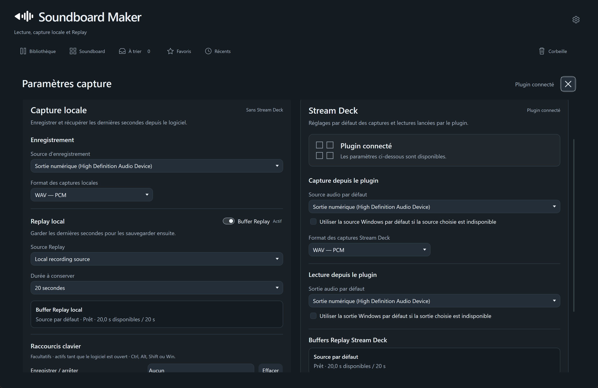
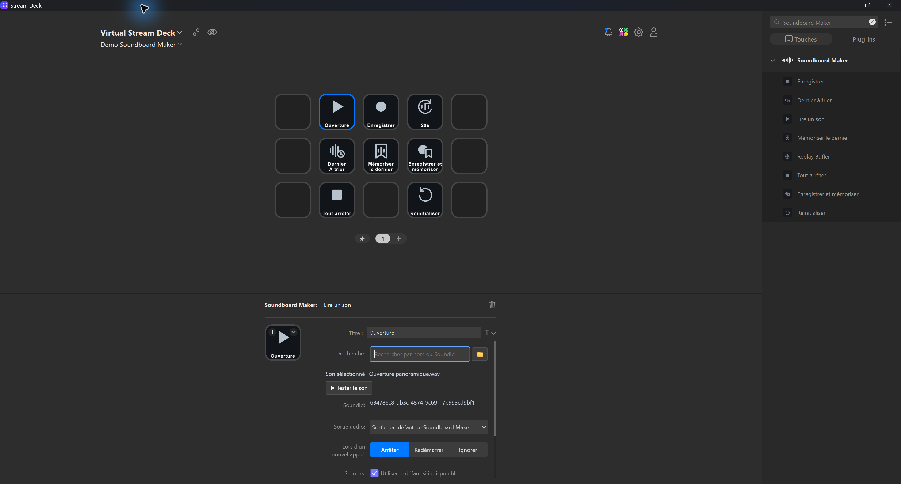
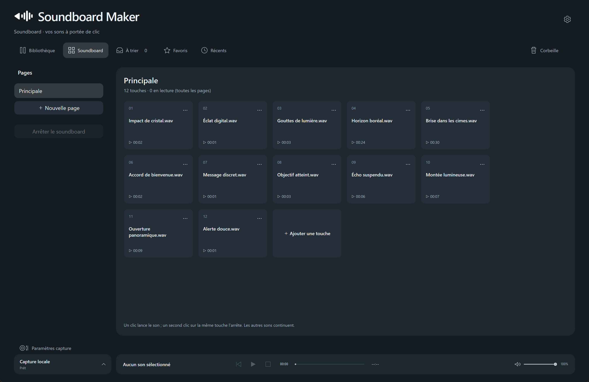

  <h3>🌐 🇫🇷 Français &nbsp; | &nbsp; <a href="README.en.md">🇬🇧 Read in English</a></h3>

  
  <h1>Soundboard Maker</h1>
  
<strong>Vos sons, à portée de main.</strong>

  
Une application Windows pour organiser, éditer, enregistrer et déclencher vos sons, avec une intégration Stream Deck.

  
<strong>Windows · Éditeur audio · Capture & Replay · Stream Deck</strong>

  
<strong>🚀 Version 1.0 en préparation</strong>

  
🌐 <strong><a href="https://sbmaker.fablitox.fr/">Visiter le site officiel — sbmaker.fablitox.fr</a></strong>

  
<a href="https://github.com/Fablitox/SoundBoardMaker/wiki/Installation-FR">Installation</a> · <a href="https://github.com/Fablitox/SoundBoardMaker/wiki/FAQ-FR">FAQ</a> · <a href="https://github.com/Fablitox/SoundBoardMaker/wiki/Accueil">Wiki</a> · <a href="https://github.com/Fablitox/SoundBoardMaker/releases">Releases</a> · <a href="https://github.com/Fablitox/SoundBoardMaker/discussions">Donner mon avis</a>

---

## Découvrez le logiciel

<table>
  <tr>
    <td align="center">
      
       <b>Bibliothèque audio</b>
    </td>
    <td align="center">
      
       <b>Éditeur audio</b>
    </td>
  </tr>
  <tr>
    <td align="center">
      
       <b>Capture & Replay</b>
    </td>
    <td align="center">
      
       <b>Stream Deck</b>
    </td>
  </tr>
</table>

*Captures réelles du logiciel. Cliquez sur les images pour les agrandir.*

### Soundboard intégré — vos sons à portée de clic

Créez plusieurs pages, organisez vos touches et déclenchez vos sons **directement depuis Soundboard Maker**, sans appareil Stream Deck. Chaque touche peut contrôler son propre son.

> **Diffusion dans le microphone (Discord, jeux) :** Elgato Wave Link est nécessaire pour router les sons vers une entrée microphone virtuelle. Il n'est pas nécessaire pour une simple écoute au casque ou sur des enceintes. [Guide de configuration](https://github.com/Fablitox/SoundBoardMaker/wiki/Wave-Link-FR).

  
   <b>Le Soundboard intégré au logiciel</b>

## Un seul endroit pour tous vos sons

Soundboard Maker rassemble une bibliothèque audio organisée, un éditeur intégré et des commandes de lecture et de capture dans une interface pensée pour une utilisation quotidienne.

| Bibliothèque | Éditeur audio | Capture & Replay | Stream Deck |
| --- | --- | --- | --- |
| Dossiers, recherche, favoris, pages et sons récents. | Découpe, aperçu original/modifié, ajustements et sauvegarde d'une copie. | Enregistrement de l'audio système et sauvegarde des dernières secondes. | Actions configurables, mémorisation, raccourcis et contrôle des lectures. |

### Les fonctionnalités principales

- **Bibliothèque locale :** import de fichiers, classement en dossiers, favoris, recherche, pages et identification persistante des sons.
- **Soundboard intégré :** pages et touches audio dans l'application, sans matériel Stream Deck.
- **Éditeur intégré :** sélection précise, découpe, aperçu, annuler/rétablir et sauvegarde du résultat dans les formats pris en charge.
- **Lecture flexible :** plusieurs sons peuvent être déclenchés indépendamment, avec des options de routage et d'arrêt.
- **Capture audio :** enregistrer l'audio système depuis le logiciel ou via les actions Stream Deck.
- **Replay Buffer :** sauvegarder les dernières secondes d'un signal audio, selon la durée configurée.
- **Plugin Stream Deck :** commandes de lecture, enregistrement, dernier son, mémoire, replay et arrêt global.
- **Interface française et anglaise.**

> Les formats disponibles pour la lecture et pour l'export ne sont pas nécessairement identiques. Consulter la [FAQ](https://github.com/Fablitox/SoundBoardMaker/wiki/FAQ-FR) pour les limites connues.

## Diffuser des sons dans votre microphone (Discord, jeux…)

**Wave Link est obligatoire pour le routage vers le microphone virtuel pris en charge par Soundboard Maker.** Pour que vos amis entendent les sons dans Discord ou un chat vocal comme s'ils provenaient de votre micro, vous devez configurer une sortie audio dans **Elgato Wave Link**, puis utiliser sa sortie microphone virtuelle (par exemple **Wave Link MicrophoneFX**) comme entrée de votre application vocale.

**Wave Link n'est pas nécessaire pour écouter simplement les sons** sur vos enceintes ou votre casque. Soundboard Maker ne crée pas à lui seul un microphone virtuel.

Consultez le [guide de configuration](https://github.com/Fablitox/SoundBoardMaker/wiki/Wave-Link-FR).

## Télécharger

**La première version publique (1.0) est en préparation. Aucun téléchargement n'est encore proposé dans ce dépôt.** Retrouvez la présentation et les guides sur le **[site officiel](https://sbmaker.fablitox.fr/)**.

Lors de sa publication, la page [Releases](https://github.com/Fablitox/SoundBoardMaker/releases) contiendra uniquement :

| Fichier | Utilisation |
| --- | --- |
| **Installateur Windows (.exe)** | Installer et mettre à jour Soundboard Maker. |
| **Plugin Stream Deck (.streamDeckPlugin)** | Téléchargement depuis cette même release GitHub et installation manuelle **jusqu'à sa publication sur Elgato Marketplace**. |

**Pas de version ZIP/portable prévue.** Vérifiez toujours la version et la provenance des fichiers avant installation.

## Installer et utiliser

Consultez le [guide d'installation](https://github.com/Fablitox/SoundBoardMaker/wiki/Installation-FR) et les [questions fréquentes](https://github.com/Fablitox/SoundBoardMaker/wiki/FAQ-FR). Soundboard Maker est conçu pour Windows 11 64 bits. Pour les commandes Stream Deck, le logiciel Elgato Stream Deck et le plugin correspondant sont nécessaires.

## Retours des utilisateurs et assistance

**Votre avis nous intéresse !** Utilisez les [Discussions Soundboard Maker](https://github.com/Fablitox/SoundBoardMaker/discussions) pour partager vos impressions, proposer une idée ou poser une question.

Pour **signaler un bug reproductible**, utilisez plutôt les [Issues GitHub](https://github.com/Fablitox/SoundBoardMaker/issues/new/choose) en suivant le [guide d'assistance](https://github.com/Fablitox/SoundBoardMaker/wiki/Assistance-FR). Ne publiez jamais vos sons personnels, journaux privés ou jetons.

## À propos de ce dépôt

Ce dépôt **public** sert exclusivement à la présentation, à la documentation et à la distribution officielle de Soundboard Maker. **Le code source et son historique de développement restent privés.** Ce dépôt ne constitue pas une publication open source.

© 2026 Soundboard Maker. Tous droits réservés.
